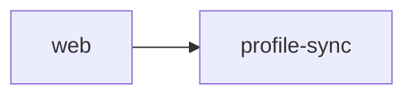

# <Feature title>

**Issue:** #<n> · **Status:** DRAFT | APPROVED | SHIPPED · **Areas:** web, profile-sync, …
**Spec by:** pm · **Design by:** architect · **Tickets by:** ticketer

## Problem

Who has it, when (on the course? at home?), and why it matters now.
Roadmap guardrail: does it improve scoring, club knowledge or practice drills? If not, why build it?

## User stories

- As a golfer mid-round, I want … so that …

## Scope

**In:** …
**Non-goals (deliberately not built):** …

## Acceptance criteria

- [ ] checkable by someone who didn't see the reasoning
- [ ] offline: works with no network / degrades with a message / n/a

## Assumptions

## Risks and open questions

---

## Design (architect)

- **What changes where:** apps/services/packages touched and why.
- **Data:** Dexie schema change (version bump?), D1 migration (additive only).
- **Contract:** `@ygb/shared` delta (types + zod). Old clients still work? How?
- **Flags:** name, default off, where it's read.
- **Offline and sync:** what happens offline, on reconnect, on a second device.
- **Rollback:** what `wrangler rollback` undoes and what it doesn't.
- **Not built, and why:**

---

## Tickets (ticketer)

| ID | Issue | Title | Area | Size | Depends on | files_touched |
| -- | ----- | ----- | ---- | ---- | ---------- | ------------- |
| T1 | #     |       |      | S    | none       |               |

Each ticket's full body (context, acceptance criteria, how to check) follows `PROCESS.md` §6.

---

## Verification (tester / orchestrator / human)

| Check | Type (automated / agent / human) | Result | Evidence | Date |
| ----- | -------------------------------- | ------ | -------- | ---- |
| `pnpm turbo run typecheck lint test build` on main | automated | | | |
| Deploy run green, health endpoints OK | agent | | | |
| Offline mid-round, reload, back online | HUMAN TODO | | | |
| Phone viewport, glare mode, greyscale | HUMAN TODO | | | |
